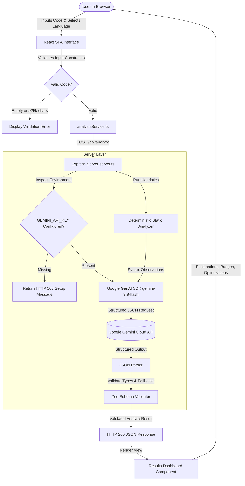
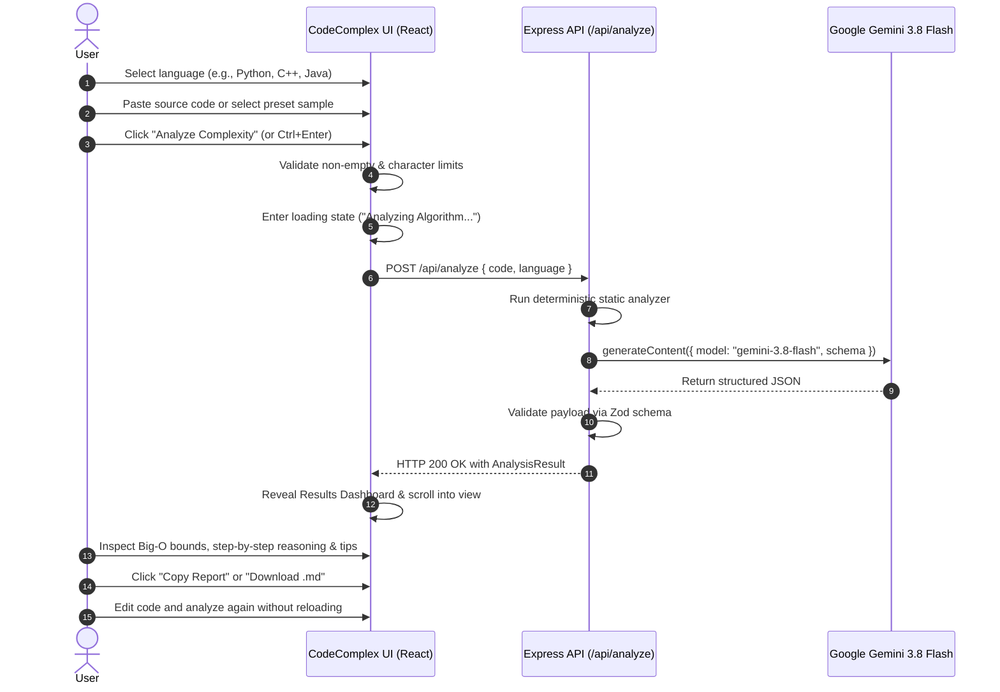

# CodeComplex AI

> **Understand Your Code. Predict Its Complexity.**

CodeComplex AI is a full-stack educational developer tool and algorithm analysis platform. It analyzes source code written in Python, C, C++, and Java, derives asymptotic time and auxiliary space complexity (Big-O notation), breaks down mathematical summations and recurrence trees in plain language, flags structural code patterns, and offers concrete optimization suggestions.

---

## 1. Project Overview

Students and software engineers frequently struggle to derive the precise time and auxiliary space complexity of algorithmic routines. Analyzing nested loops with dependent boundaries, divide-and-conquer recurrences, recursive branching depth, early exits, and hidden standard library allocations requires rigorous theoretical background.

CodeComplex AI bridges this gap by combining:
1. **Deterministic Static Pattern Analysis:** Fast, syntax-based detection of loops, nesting depths, logarithmic step indicators, recursion signatures, and dynamic memory allocations.
2. **Deep Asymptotic AI Reasoning:** Powered server-side by Google's **Gemini 3.8 Flash** model, calculating worst-case, average-case, and best-case complexities with step-by-step mathematical justifications.
3. **Strict Runtime Schema Validation:** Enforced via **Zod**, guaranteeing reliable, structured data without hallucinations or malformed JSON.
4. **Interactive Developer Workspace:** A responsive, accessible single-page application with preset canonical algorithms, line numbering, custom font ligatures, and markdown report export.

---

## 2. Problem Statement & Objectives

### The Problem
Manual algorithmic complexity analysis is error-prone. Many learners apply naive heuristics—such as assuming that two nested loops always mean $O(n^2)$, or confusing input storage with auxiliary scratchpad memory. Furthermore, standard compiler warnings rarely report asymptotic Big-O growth.

### Core Objectives
* Provide a single, intuitive interface to evaluate algorithms without installing local compilers or runtimes.
* Accurately distinguish worst-case $O(f(n))$, best-case $\Omega(f(n))$, and average-case $\Theta(f(n))$ when mathematically justified.
* Explicitly differentiate **Auxiliary Space Complexity** (extra memory allocated on heap/stack) from the input size.
* Present plain-language derivations explaining loop counters, recursion trees, and data structure footprints.
* Provide actionable optimization recommendations with trade-off explanations.
* Support real-time repeat analysis without page reloads.

---

## 3. Key Features

* **Multi-Language Support:** Select between Python, C++, C, and Java.
* **Asymptotic Time Complexity:** Derives worst-case Big-O bounds, and best/average cases where justified.
* **Auxiliary Space Breakdown:** Separates recursion stack depth and dynamic heap allocations from input buffers.
* **Preset Canonical Algorithms:** One-click loading of 6 foundational algorithmic classes:
  1. Constant Time Array Lookup ($O(1)$)
  2. Linear Array Traversal ($O(n)$)
  3. Binary Search ($O(\log n)$)
  4. Nested Pair Comparison ($O(n^2)$)
  5. Merge Sort ($O(n \log n)$)
  6. Naive Recursive Fibonacci ($O(2^n)$)
* **Deterministic Static Heuristics:** Displays local syntax observations alongside AI reasoning.
* **Code Insights & Pattern Badges:** Categorizes loops, bisection steps, early exits, and memory allocations.
* **Actionable Optimization Advice:** Highlights algorithmic bottlenecks and trade-offs (e.g. converting nested loops to hash lookups).
* **Exportable Reports:** One-click clipboard copy or download as clean `.md` Markdown files.
* **Full Responsive Design:** Mobile-first layout with smooth single-column stacking and touch targets.
* **Privacy & Safety:** Submitted code is processed strictly as text—never compiled, sandboxed, or executed on the server.

---

## 4. Technology Stack

| Layer | Technology | Rationale |
|---|---|---|
| **Frontend Framework** | React 19 + TypeScript | High performance, type safety, modular component lifecycle. |
| **Build & Dev Tool** | Vite 8 | Ultra-fast bundling, ES modules, modern developer experience. |
| **Styling** | Tailwind CSS v4 | Utility-first, zero runtime overhead, responsive design tokens. |
| **Icons & Typography** | Lucide React + Inter & JetBrains Mono | Clean developer-oriented typography and iconography. |
| **Backend & Middleware** | Node.js + Express + `tsx` | Secure server-side proxy for API key encapsulation. |
| **AI Engine** | Google Gemini API (`gemini-3.8-flash`) | State-of-the-art multimodal reasoning, structured JSON outputs. |
| **Schema Validation** | Zod | Strict runtime validation and fallback defaults for model responses. |
| **Testing** | Vitest | Fast unit testing for static analyzer, Zod schemas, and sample programs. |

---

## 5. System Architecture



---

## 6. User Workflow



---

## 7. Folder Structure

```text
codecomplex-ai/
├── public/
│   └── assets/                     # Static media and assets
├── src/
│   ├── components/
│   │   ├── Header.tsx              # Responsive navigation and live AI status
│   │   ├── Hero.tsx                # Hero banner with feature indicators
│   │   ├── CodeEditor.tsx          # Dual-column editor with line numbers & presets
│   │   ├── AnalysisResults.tsx     # 3 summary cards, derivation, insights & export
│   │   ├── ComplexityGuide.tsx     # Reference table and SVG growth chart
│   │   ├── AboutSection.tsx        # Project background, methodology, and disclaimer
│   │   └── Footer.tsx              # Footer with links and academic attribution
│   ├── data/
│   │   └── examples.ts             # 6 canonical algorithm samples in 4 languages
│   ├── services/
│   │   └── analysisService.ts      # HTTP client and health check service
│   ├── types/
│   │   └── analysis.ts             # TypeScript definitions for complexity structures
│   ├── utils/
│   │   ├── schema.ts               # Zod validation schema and normalization
│   │   └── staticAnalyzer.ts       # Deterministic static pattern detection
│   ├── App.tsx                     # Main application orchestrator
│   ├── index.css                   # Tailwind v4 styling & design tokens
│   └── main.tsx                    # React DOM entry point
├── tests/
│   ├── examples.test.ts            # Validates all sample programs across languages
│   ├── schema.test.ts              # Validates Zod parsing and fallback behavior
│   └── staticAnalyzer.test.ts      # Validates local loop, recursion, and memory checks
├── .env.example                    # Placeholder environment variables
├── index.html                      # HTML entry point with synchronized SEO meta
├── metadata.json                   # AI Studio applet metadata & capabilities
├── package.json                    # Project scripts and dependencies
├── server.ts                       # Express backend with Gemini API proxy
├── tsconfig.json                   # TypeScript configuration
├── vite.config.ts                  # Vite build and dev configuration
└── README.md                       # Comprehensive documentation
```

---

## 8. API Documentation

### 1. Health Check
* **Endpoint:** `GET /api/health`
* **Description:** Returns the operational status of the server and verifies if `GEMINI_API_KEY` is loaded.
* **Response (HTTP 200):**
```json
{
  "status": "ok",
  "geminiConfigured": true,
  "model": "gemini-3.8-flash",
  "environment": "development"
}
```

### 2. Code Complexity Analysis
* **Endpoint:** `POST /api/analyze`
* **Headers:** `Content-Type: application/json`
* **Request Body:**
```json
{
  "code": "def binary_search(arr, target):\n    low = 0\n    high = len(arr) - 1\n    while low <= high:\n        mid = (low + high) // 2\n        if arr[mid] == target:\n            return mid\n        elif arr[mid] < target:\n            low = mid + 1\n        else:\n            high = mid - 1\n    return -1",
  "language": "python"
}
```
* **Validation Rules:**
  * `code`: String, non-empty, max 25,000 characters.
  * `language`: One of `python`, `cpp`, `c`, `java`.
* **Response (HTTP 200):**
```json
{
  "language": "python",
  "summary": "Iterative binary search on a sorted collection.",
  "timeComplexity": {
    "worstCase": "O(log n)",
    "averageCase": "O(log n)",
    "bestCase": "O(1)",
    "explanation": "In each iteration, the remaining search window is halved..."
  },
  "spaceComplexity": {
    "auxiliary": "O(1)",
    "explanation": "Only primitive integer pointers (low, high, mid) are allocated..."
  },
  "inputAssumptions": [
    "The input array is already sorted in ascending order",
    "Random-access element indexing runs in O(1) time"
  ],
  "codePatterns": [
    { "type": "loop", "description": "Single while loop with index bisection" },
    { "type": "early-return", "description": "Returns index immediately upon finding match" }
  ],
  "staticObservations": [
    "Single non-nested loop structure observed",
    "Index bisection, halving or doubling patterns detected"
  ],
  "optimizationSuggestions": [],
  "limitations": [
    "Requires the sorted prerequisite; searching an unsorted array requires O(n) or an O(n log n) initial sort"
  ],
  "confidence": {
    "level": "high",
    "reason": "Canonical iterative binary search pattern with strictly bounded logarithmic division"
  },
  "analyzedAt": "2026-10-20T15:25:00.000Z"
}
```
* **Error Responses:**
  * `400 Bad Request`: `{ "error": "Please enter source code to analyze." }`
  * `503 Service Unavailable`: `{ "error": "GEMINI_API_KEY is not configured on the server..." }`
  * `500 Internal Server Error`: `{ "error": "Failed to analyze code...", "details": "..." }`

---

## 9. Complexity Reference Matrix

| Complexity | Common Term | Concrete Example | Growth Rate ($n=10 \to n=100$) |
|---|---|---|---|
| $O(1)$ | Constant | Array element lookup by index | $1 \to 1$ operations |
| $O(\log n)$ | Logarithmic | Binary search in sorted array | $3.3 \to 6.6$ operations |
| $O(n)$ | Linear | Single pass array traversal | $10 \to 100$ operations |
| $O(n \log n)$ | Linearithmic | Merge sort, Heapsort | $33 \to 664$ operations |
| $O(n^2)$ | Quadratic | Nested loop pair comparisons | $100 \to 10,000$ operations |
| $O(2^n)$ | Exponential | Unmemoized recursive Fibonacci | $1,024 \to 1.26 \times 10^{30}$ operations |

---

## 10. Installation & Setup

### Prerequisites
* **Node.js:** v18.0.0 or higher (v20+ recommended)
* **npm:** v9.0.0 or higher
* **Google Gemini API Key:** Obtainable from [Google AI Studio](https://aistudio.google.com/)

### Step-by-Step Setup

1. **Clone or Navigate to the Repository:**
   ```bash
   cd codecomplex-ai
   ```

2. **Install Dependencies:**
   ```bash
   npm install
   ```

3. **Configure Environment Variables:**
   Copy `.env.example` to create your local `.env`:
   ```bash
   cp .env.example .env
   ```
   Edit `.env` and set your key:
   ```env
   GEMINI_API_KEY="your-actual-gemini-api-key"
   PORT=3000
   ```
   *(Note: In Google AI Studio, `GEMINI_API_KEY` is injected automatically via secrets.)*

4. **Start the Development Server:**
   ```bash
   npm run dev
   ```
   Open your browser at `http://localhost:3000`.

5. **Run the Test Suite:**
   ```bash
   npm test
   ```

6. **Validate TypeScript & Build:**
   ```bash
   npm run lint
   npm run build
   ```

---

## 11. Security & Privacy Considerations

1. **No Client-Exposed Credentials:** The Gemini API key is managed exclusively server-side. Browser bundles and network inspection tools never have access to private secrets.
2. **Untrusted Code Handling:** Submitted code is treated strictly as plain text. It is never compiled, evaluated with `eval()`, or executed in a shell.
3. **Data Processing Disclosure:** The user is informed upfront that source code is transmitted to Google's Gemini API for asymptotic analysis.
4. **Input Size Limits:** Requests are capped at 25,000 characters to prevent buffer-exhaustion attacks and unintended API credit usage.
5. **No Persistent Code Storage:** Code is not saved to any database or persistent storage without user intent.

---

## 12. Academic Project Information

* **Project Title:** CodeComplex AI: Asymptotic Algorithm Complexity Analysis & Education Platform
* **Category:** Educational Developer Tool / Applied AI in Computer Science Education
* **Abstract:** Understanding computational complexity is a core foundational pillar of computer science. Students and practicing engineers routinely encounter difficulty determining the asymptotic scaling behavior of non-trivial code routines. CodeComplex AI delivers a hybrid analysis engine combining deterministic static heuristics with large language model algorithmic reasoning. By breaking down loop counters, recurrence relations, and auxiliary memory footprints into plain language, the platform accelerates algorithmic literacy and promotes proactive code optimization.
* **Limitations:** The application serves as an educational guidance instrument, not a formal mathematical proof checker. While predictions are grounded in structural code analysis, complex dynamic dispatch, non-deterministic branching, or external library calls may introduce uncertainty.

---

## 13. Troubleshooting

| Issue | Cause | Solution |
|---|---|---|
| **"GEMINI_API_KEY is not configured"** | Environment variable missing or placeholder used | Add `GEMINI_API_KEY` to `.env` or set it in the AI Studio Secrets panel. |
| **"Analysis Failed: 400 Bad Request"** | Empty code submitted or length exceeds 25k chars | Ensure non-empty code within 25,000 characters is provided. |
| **"Port 3000 already in use"** | Another process is occupying port 3000 | Specify a different port using `PORT=3001 npm run dev`. |
| **"Network Error / Failed to Fetch"** | Backend server is not running | Ensure `npm run dev` (running `tsx server.ts`) is active. |

---

## 14. License

This academic project is currently provided for educational and evaluation purposes. A formal open-source license (such as MIT or Apache 2.0) may be designated by the repository owner upon final publication.
